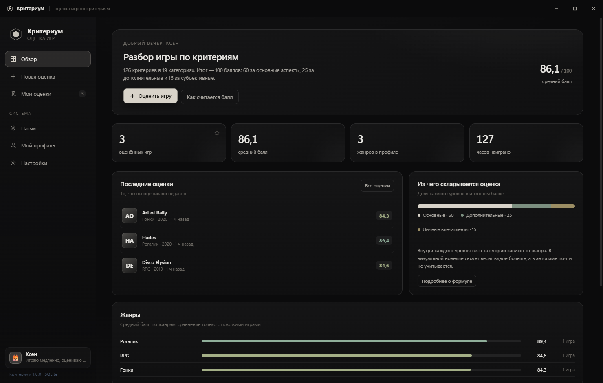
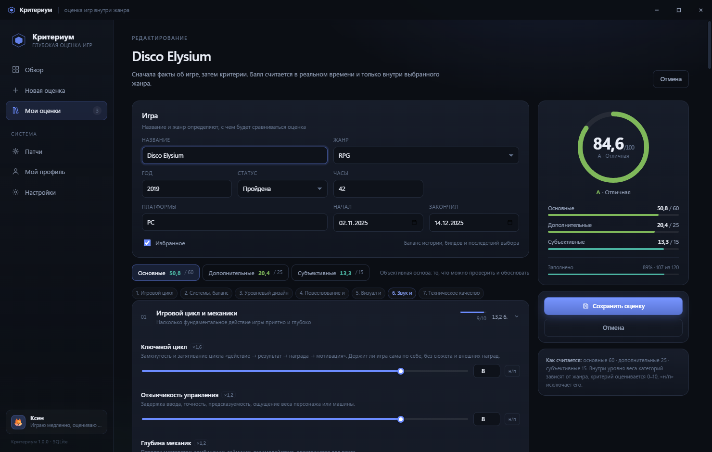
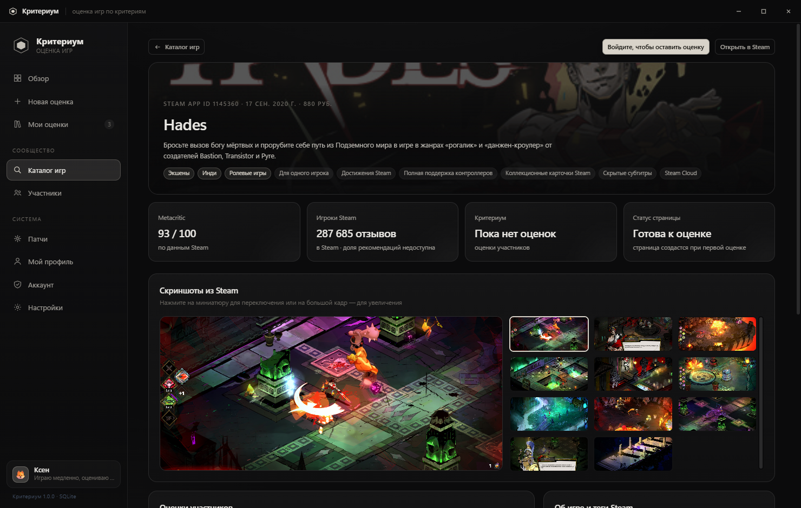

# Критериум {VERSION}

_Шаблон описания релиза. При выпуске новой версии скопируйте файл, замените {VERSION}
и перечень изменений, затем укажите файл в `gh release create/edit vX.Y.Z --notes-file`._
# Критериум 1.1.0

Оценка видеоигр по критериям — настольное приложение для Windows.

**Критериум** — личный инструмент игрового критика. Вы оцениваете игру не одним числом «нравится / не нравится», а **126 критериями** в **19 категориях**, разложенными на три уровня: основные стороны игры (60), условия её существования (25) и личный опыт (15). Балл считается по прозрачной формуле, а сравнение всегда идёт **внутри жанра**: рогалик не соревнуется с автосимом, потому что у них разные жанровые веса — 30 жанровых профилей автоматически перестраивают важность категорий.

Нужно понимать, откуда взялся каждый балл? Разбор по категориям вкладывается в каждую оценку: читатель видит сильные и слабые стороны, покрытие и «черновые» зоны.

## Что в этой сборке

- 🖼 Обложки страниц Steam-игр в высоком разрешении (~1920px) — без растянутых пикселей; для Dota 2 — официальная обложка с логотипом.
- 🎯 Жанр оценки подставляется из Steam автоматически: жанровые веса, подсказки и шкала перестраиваются вместе с игрой.
- ⚪ Аккуратный круговой индикатор балла: чистые пустые состояния и плавная прорисовка.
- 🔧 Полировка настроек и интерфейса; системные инструменты не мешают обычному пользователю.
- ⚙️ Автообновление: приложение само проверяет новый релиз, скачивает его и заменяет свой exe без переустановки. Проверить вручную — «Настройки → Обновления».

> Если вы скачали более раннюю сборку 1.1.0 и приложение падало при запуске с ошибкой «Cannot find module './updater'» — скачайте exe заново, файл в этом релизе исправлен.

## Установка

1. Скачайте `Kriterium-1.1.0.exe` из блока Assets ниже.
2. Запустите. Портативный exe (~95 МБ) не требует установки: можно положить в любую папку.
3. Приложение работает офлайн как личный дневник оценок. По желанию подключается общий каталог Steam и сообщество.

Личные данные хранятся локально (`%APPDATA%\kriterium\data\kriterium.db`), резервные копии — через «Экспорт» в профиле.

## Скриншоты

| Оценка | Страница игры из Steam |
| --- | --- |
|  |  |

## Ссылки

- Новости и обсуждения: [Telegram-канал](https://t.me/Kriteriumapp)
- Полное описание системы оценки, формулы и патчей: [README](https://github.com/Xerenyn/kriterium#readme)
- Исходный код: открыт, vanilla JS + Electron без сборки интерфейса

