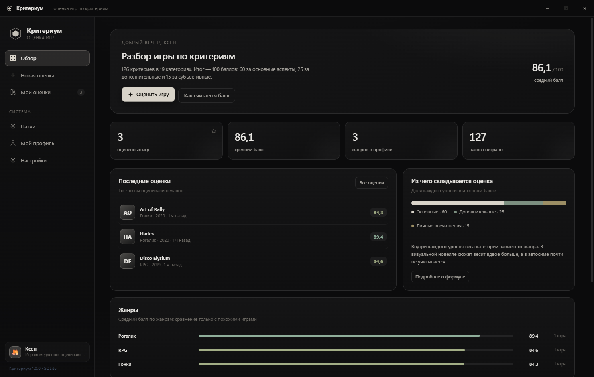
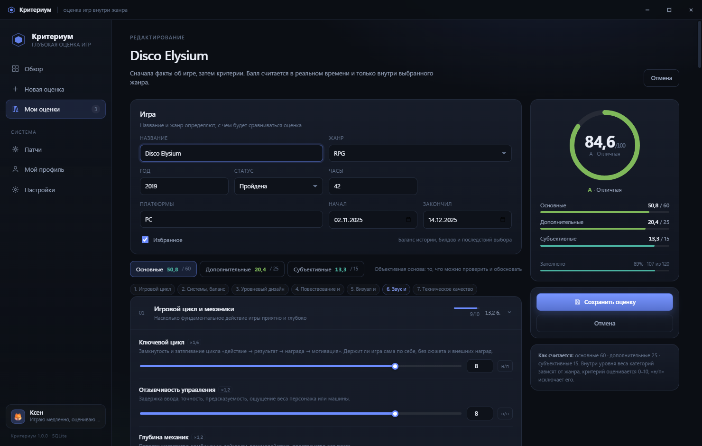
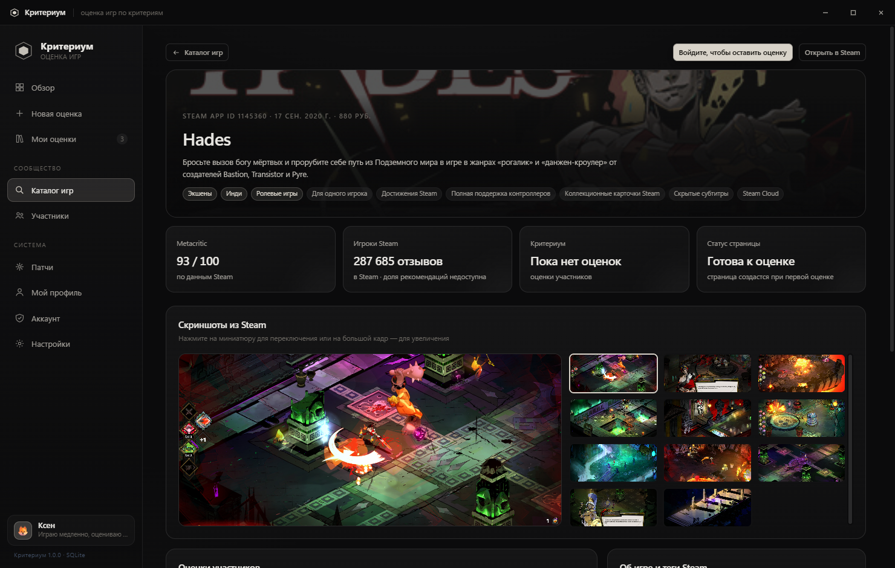
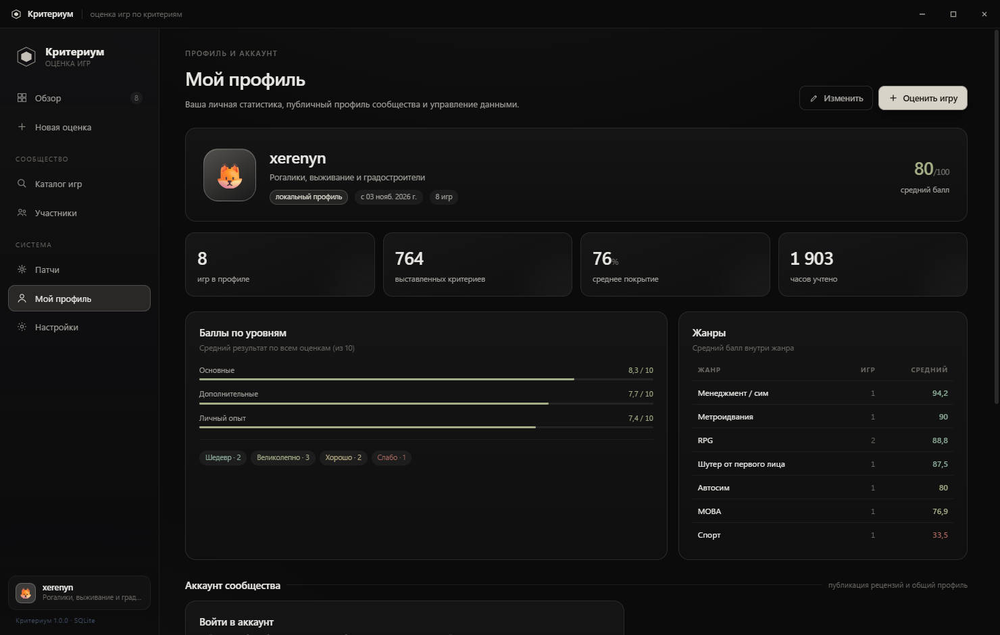
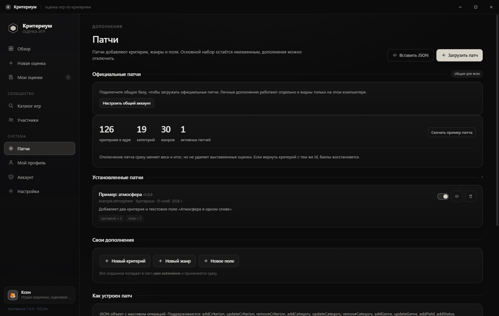

# Критериум

Настольное приложение для оценки видеоигр, с общими страницами игр, аккаунтами участников и локальной копией личных данных.

Новости и обсуждения — в Телеграм-канале: **[t.me/Kriteriumapp](https://t.me/Kriteriumapp)**



| Оценка | Общая страница игры |
| --- | --- |
|  |  |

| Мой профиль | Патчи и общая база |
| --- | --- |
|  |  |

## Что это

**Критериум** — личный инструмент игрового критика. Вы оцениваете игру не одним числом «нравится / не нравится», а 126 критериями, разложенными на три уровня. Балл считается по прозрачной формуле, а сравнение всегда идёт **внутри жанра**: рогалик не соревнуется с автосимом, потому что у них разные жанровые веса.

Обновления не требуют переустановки: при выходе нового релиза приложение само предложит скачать его, а после нажатия «Установить» — заменит свой exe и перезапустится уже на новой версии. Все данные при этом сохраняются. Проверить вручную можно в «Настройки → Обновления».

Личная библиотека и черновики хранятся локально в SQLite. По желанию можно подключить общий сервер Supabase: там находятся аккаунты, каталог Steam, публичные профили и опубликованные оценки. Поиск и сведения об играх загружаются из Steam Store.

## Система оценки

### Три уровня

| Уровень | Баллы | Что описывает |
| --- | ---: | --- |
| **Основные** | **60** | Игровой цикл, системы, уровни, сюжет, визуал, звук, техника |
| **Дополнительные** | **25** | UX, объём, онлайн, поддержка, монетизация, оригинальность |
| **Личный опыт** | **15** | Интерес, длина сессии, эмоции, личная ценность, время и подходящая сложность |

Основные критерии дают в четыре раза больше субъективных. Это сделано намеренно: личный опыт важен, но он не должен подменять разбор произведения.

### 126 критериев в 19 категориях

**Основные (60):**
- Игровой цикл и механики — 10 критериев
- Системы, баланс и прогрессия — 9
- Уровневый дизайн и мир — 9
- Повествование и текст — 10
- Визуал и арт-дирекшн — 8
- Звук и музыка — 7
- Техническое качество — 7

**Дополнительные (25):**
- Интерфейс, онбординг, доступность — 8
- Объём, разнообразие, реиграбельность — 8
- Сетевые и социальные функции — 6
- Поддержка, моды, сообщество — 6
- Монетизация и уважение к игроку — 6
- Оригинальность и влияние — 6

**Субъективные (15):**
- Вовлечённость — 5
- Удержание сессии — 4
- Эмоциональный отклик — 5
- Личная ценность — 4
- Уважение к времени — 4
- Сложность и темп игры — 4

У каждого критерия есть подсказка «что оценивать», а у ключевых — якоря для 0, 5 и 10, чтобы шкала не расплывалась.

### Формула

1. **Жанровый профиль.** У каждой категории есть множитель жанра `m`. Для RPG сюжет весит `×1,45`, для автосима — `×0,05`. Эффективный вес категории: `W = w × m`.
2. **Баллы категории.** Внутри уровня веса нормализуются: `P = P_уровня × W / ΣW`. Уровень всегда даёт свои 60 / 25 / 15.
3. **Балл категории (0–10).** Взвешенное среднее критериев: `S = Σ(w × r) / Σw`.
4. **Вклад уровня.** `E = Σ P × S / 10`.
5. **Итог.** `Σ E` по трём уровням, округление до 0,1.

Если категория не заполнена, её баллы перераспределяются между заполненными, а **покрытие** показывается отдельно. При покрытии ниже 50% балл помечается как черновой.

Отметка **«н/п»** исключает критерий из расчёта — например, сетевые функции в одиночной игре.

### Жанры

30 профилей: экшен, приключение, RPG, JRPG, шутеры, стелс, хоррор, стратегии в реальном времени и пошаговые стратегии, рогалик, метроидвания, платформер, гонки, автосим, спорт, файтинг, головоломка, выживание, MMO, MOBA, королевская битва, градостроительство, менеджмент, песочница, визуальная новелла, симулятор прогулки, карточная игра с колодой, ритм-игра и симулятор со свободой действий.

## Возможности приложения

- **Мой профиль** — локальный аккаунт: имя, аватар, акцентный цвет, статистика по жанрам, средние баллы по уровням, экспорт и импорт.
- **Оценка** — форма с живым пересчётом балла, ползунками, полем «н/п», подсказками и автосохранением черновика.
- **Библиотека** — поиск, фильтры по жанру и статусу, сортировка по баллу, часам и дате.
- **Карточка игры** — радар основных аспектов, сравнение со средним по жанру, разбор по категориям, сильные и слабые стороны, экспорт в Markdown.
- **Каталог Steam** — поиск игры по названию и общая страница по Steam App ID.
- **Сообщество** — регистрация по электронной почте, публичные профили и оценки участников на страницах игр.
- **Официальные патчи** — общие изменения каталога публикует только аккаунт разработчика. Личные дополнения остаются на компьютере пользователя.
- **Данные** — экспорт профиля в JSON, таблица оценок в CSV, резервные копии.

## Общая база и аккаунты

Сетевые функции используют Supabase (PostgreSQL + Auth + REST API). Без настройки Supabase программа продолжает работать как личный офлайн-дневник.

Чтобы включить общий каталог:

1. Создайте проект Supabase.
2. Откройте **SQL Editor** и выполните `supabase/migrations/0001_shared_catalog.sql`.
3. Запустите приложение, откройте **Аккаунт**, укажите Project URL и публичный `publishable` / `anon` key.
4. Создайте аккаунт и подтвердите электронную почту.
5. Если это аккаунт владельца, замените пример email в `supabase/bootstrap-developer.sql` на свой подтверждённый адрес и выполните скрипт в SQL Editor.

Ключ `service_role` никогда не вставляется в приложение и не должен попадать в репозиторий. Назначить разработчика могут только владелец проекта Supabase через SQL Editor; участники не могут выдать эту роль себе. Права разработчика управляют **общими официальными патчами**, а не файлами программы, установленными на чужом компьютере.

После подключения репозитория к GitHub автоматическое применение новых миграций включается добавлением GitHub Actions secret `SUPABASE_DB_URL` (строка подключения к базе Supabase) в **Settings → Secrets and variables → Actions**. Workflow `Apply Supabase migrations` запускает `supabase db push` при изменении файлов `supabase/migrations/`. Если секрета ещё нет, workflow безопасно пропускает деплой.

Страница игры связывается со Steam по App ID. Steam предоставляет поиск и часть метаданных, включая Metacritic для некоторых игр; оценки Metacritic доступны не для всего каталога. Сводная оценка Критериума считается по публичным оценкам участников. Данные других внешних рейтингов можно добавить отдельным серверным источником; скрейпить сайты без разрешения не следует.

## Патчи

Патч — это JSON-пакет операций. Он не меняет ядро, а накладывается поверх; отключение патча сразу пересчитывает баллы, но не удаляет выставленные оценки.

```json
{
  "id": "my.patch",
  "name": "Мои критерии",
  "version": "1.0.0",
  "operations": [
    {
      "op": "addCriterion",
      "categoryId": "audio",
      "criterion": {
        "id": "custom.audio.afterglow",
        "name": "Звуковой след",
        "w": 1,
        "hint": "Вспоминается ли музыка после выхода из игры."
      }
    }
  ]
}
```

Поддерживаемые операции:

| Операция | Назначение |
| --- | --- |
| `addCriterion` / `updateCriterion` / `removeCriterion` | Критерии |
| `addCategory` / `updateCategory` / `removeCategory` | Категории |
| `addGenre` / `updateGenre` / `removeGenre` | Жанры и их множители |
| `addField` / `removeField` | Дополнительные поля карточки |
| `addStatus` | Статусы прохождения |

Готовый пример: [`patches/example-atmosphere.json`](patches/example-atmosphere.json). В приложении есть конструктор: «Патчи → Новый критерий / Новый жанр / Новое поле».

## Запуск

Нужен Node.js 22+ (проверено на Node 26 / Electron 40).

```bash
npm install
npm start
```

Сборка переносимого `.exe`:

```bash
npm run dist
```

Результат появится в `release/`.

Где лежат данные:

```
%APPDATA%\kriterium\data\kriterium.db
```

Резервная копия — кнопка «Экспорт профиля» на экране профиля или в настройках.

## Горячие клавиши

- `Ctrl+N` — новая оценка
- `Ctrl+S` — сохранить оценку
- `F12` — инструменты разработчика
- `Esc` — закрыть модальное окно

## Структура

```
main.js                 главный процесс Electron, IPC, окно
preload.js              безопасный мост renderer → main
src/core/store.js       SQLite: профиль, игры, оценки, патчи
src/core/cloud.js       Supabase Auth, общий каталог, Steam API, отзывы
src/data/catalog.json   ядро: 126 критериев, 19 категорий, 30 жанров
src/renderer/           интерфейс (vanilla JS, без сборки)
  js/scoring.js         патчи, жанровые веса, формула
  js/editor.js          форма оценки
  js/app.js             маршруты, обзор, библиотека, карточка
  js/pages.js           профиль, патчи, настройки
  js/social.js          аккаунт, Steam-каталог, общие страницы и профили
supabase/                SQL-схема и назначение разработчика
patches/                примеры патчей
scripts/                seed и smoke-тесты
```

## Тесты

```bash
node scripts/seed.js C:\Temp\krit-test\data
```

Сквозной smoke-тест запускается через Electron: он проверяет каталог, формулу (все 10 → 100, все 0 → 0), «н/п», сохранение игры, установку и удаление патча и рендер 31 маршрута и состояния. Скрипт: `scripts/smoke-renderer.js`.

Проверка правил подключения и серверных прав:

```bash
npm run test:cloud
```

Реальную регистрацию, общие оценки и права разработчика можно проверить после подключения проекта Supabase.

## Об объективности

Полностью объективной оценки игры не существует. Задача системы — не изобразить объективность, а сделать субъективность **явной и ограниченной**: основные критерии описывают проверяемые свойства, дополнительные — условия существования игры, субъективные — личный опыт. Читатель оценки видит, откуда взялся каждый балл.
